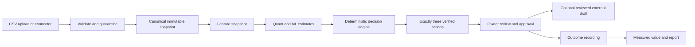
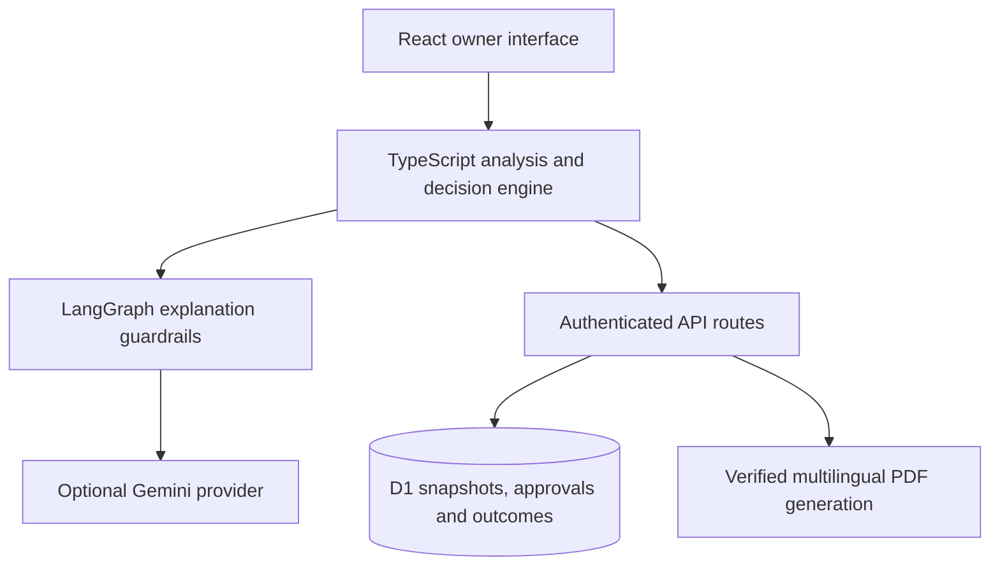
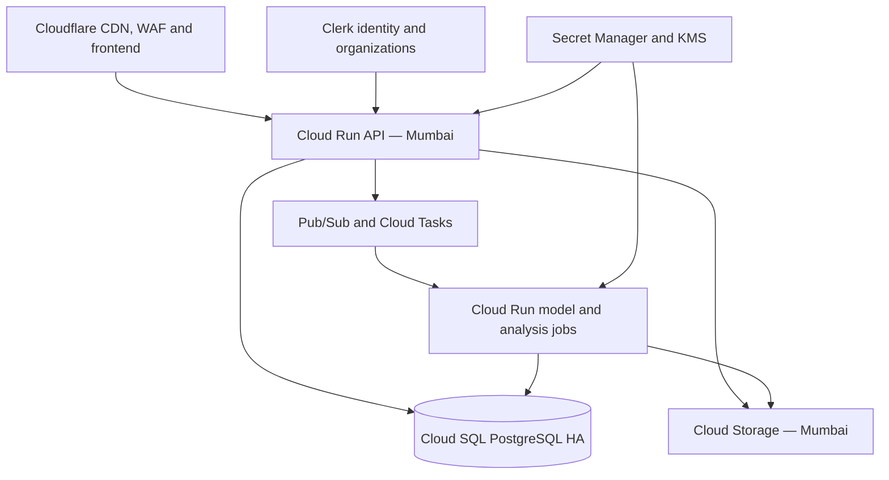

# Argus — MSME Working-Capital Decision Platform

Argus helps Indian micro, small, and medium enterprises decide what to buy, which payments to collect, and which purchases to pause while protecting cash reserves.

It converts sales, inventory, receivables, supplier, purchase, and cash-commitment data into exactly three traceable daily decisions. Statistical and machine-learning models estimate demand, uncertainty, anomalies, and supplier-cost pressure; the deterministic TypeScript engine remains authoritative for quantities, cash, reserve protection, prioritization, and financial amounts.

> Quant predicts. Verified code calculates. AI explains. The owner decides.

## Contents

- [Product principles](#product-principles)
- [What Argus does](#what-argus-does)
- [Current implementation status](#current-implementation-status)
- [How the decision pipeline works](#how-the-decision-pipeline-works)
- [Quant and ML system](#quant-and-ml-system)
- [Authentication and tenant security](#authentication-and-tenant-security)
- [Data inputs](#data-inputs)
- [Architecture](#architecture)
- [Local development](#local-development)
- [Environment variables](#environment-variables)
- [Testing and verification](#testing-and-verification)
- [API routes](#api-routes)
- [Repository structure](#repository-structure)
- [Deployment](#deployment)
- [Security and privacy](#security-and-privacy)
- [Production launch gates](#production-launch-gates)
- [Contributing](#contributing)

## Product principles

Argus follows the owner-oriented sequence:

**See → Understand → Decide → Act → Review**

The platform preserves these guarantees:

- Exactly three verified decisions are produced for every valid business check.
- Recommendations show the reason, expected impact, evidence, and next step.
- No supplier order, customer message, or other external action is sent automatically.
- An authorized person must approve every external action.
- A WhatsApp control opens only a reviewed draft after approval; Argus never sends it automatically.
- AI-generated language cannot alter actions, quantities, amounts, confidence, evidence, or approval eligibility.
- Zero-value abstentions remain visible as “No action needed” instead of becoming false alerts.
- Original CSV files are not silently modified.
- Recorded outcomes are kept separate from estimated impact.

## What Argus does

### Owner-first experience

The application provides five primary workspaces after onboarding:

1. **Home** — overall business condition, top recommendation, safe-to-spend amount, protected cash, and attention items.
2. **Actions** — exactly three ranked decisions with approval and outcome workflows.
3. **Money** — 13-week cash outlook, payments to collect, purchasing capacity, reserve pressure, and supplier-cost exposure.
4. **Reports** — the latest verified PDF report and measured outcomes.
5. **More** — data quality, unusual activity, language preferences, safeguards, and technical evidence.

The focused onboarding flow is:

**Add data → Check data → See results**

### Decision types

The authoritative engine returns three decisions drawn from:

- **Reorder or hold** — calculates lead-time demand, available stock, safety stock, MOQ/package rounding, and cash-safe approved quantity.
- **Collect or abstain** — identifies a suitable receivable follow-up while preserving relationship-sensitive choices.
- **Pause purchase or review supplier cost** — compares excess-stock capital with verified supplier-price and margin risk.

The engine does not manufacture additional actions from anomaly findings.

### Cash and operational analysis

Argus currently includes:

- Safe-to-spend purchasing capacity.
- Owner-entered protected cash reserve.
- Expected and conservative 13-week cash projections.
- Probability-weighted receivable inflows.
- Committed cash outflows.
- First projected reserve-pressure week.
- Demand, stock, returns, pricing, receivables, and data-quality checks.
- Supplier landed-cost and margin-risk analysis.
- Scenario controls for budget, reserve, lead time, demand, payment timing, supplier quote, and target margin.
- Immutable analysis snapshots for approvals and reporting.
- Approval reconciliation against the latest verified action.
- Outcome recording and seven-day measured-value summaries.
- PDF reports in 12 supported languages.

## Current implementation status

This repository contains a working application plus a production infrastructure foundation. It is important not to confuse committed architecture with a completed regulated production rollout.

| Area | Implemented in this repository | External rollout still required |
|---|---|---|
| Owner UI | Responsive Home, Actions, Money, Reports, More, onboarding, evidence, scenarios, approvals, outcomes | Production usability study and final WCAG audit |
| Decision engine | Deterministic calculations and exactly-three-action contract | Numerical parity sign-off against production migration data |
| Quant v2 | Rolling-origin validation, SKU segmentation, TSB/Croston/baselines, uncertainty and evaluation metadata | Four-week multi-tenant shadow evaluation |
| Cost intelligence | Dated purchase-ledger ingestion, landed cost, robust Ridge fallback, promotion eligibility | Tenant-local LightGBM training jobs and pilot validation |
| ML challenger | Python LightGBM pipeline, artifact metadata and promotion gates | Artifact Registry images, scheduled jobs and champion operations |
| Authentication | Clerk JWT verification adapter, organization-derived tenant, role permissions, hosted Sites identity compatibility | Clerk application, OTP/MFA/dashboard policies, invitations and account recovery configuration |
| Persistence | Current D1 snapshots/approvals/outcomes plus production PostgreSQL schema with RLS | Cloud SQL migration and restore testing |
| Infrastructure | Terraform foundation for Mumbai Cloud Run, Cloud SQL, Cloud Storage and Pub/Sub | Reviewed Terraform plan/apply in the production GCP project |
| Security | Server-derived tenant boundary, permission checks, approval reconciliation, dependency audit | Penetration test, SOC 2 controls, incident exercise and DPDP legal review |

## How the decision pipeline works



The model layer is advisory. It may provide forecasts, intervals, residual scores, anomaly signals, and expected supplier costs. The deterministic layer owns:

- Purchase quantity and affordability.
- Cash reserve protection.
- MOQ and package-size rounding.
- Action order and urgency.
- Financial amounts shown to the owner.
- Approval eligibility.

The language/reasoning layer receives a compact verified package. A numeric allowlist and structural validator reject unsupported values or altered actions. If the provider is missing or fails validation, Argus returns a deterministic explanation without blocking calculations, approval, or reporting.

## Quant and ML system

### Demand forecasting v2

Demand forecasting operates per tenant and per SKU with a champion/challenger policy.

Implemented model families include:

- Moving-average fallback.
- Seasonal naive.
- Exponential smoothing.
- Croston intermittent-demand forecasting.
- TSB intermittent-demand forecasting.
- Tenant-local LightGBM challenger foundation.

The pipeline:

1. Builds the full calendar series, including zero-demand days.
2. Classifies each SKU as regular, intermittent, lumpy, new, or inactive.
3. Uses three rolling-origin temporal validation folds when history permits.
4. Calculates WAPE, MASE, bias, pinball loss, and interval coverage metadata.
5. Retains seasonal naive as the baseline unless a challenger improves weighted error by at least 5%.
6. Marks results as `reliable`, `limited`, or `abstained` with a plain-language reason.
7. Provides forecast intervals and preserves model version and validation metadata.

Random train/test splitting is deliberately avoided for time-series evaluation.

### Supplier-cost intelligence v2

The dated purchase ledger supplies order date, receipt date, quantity, unit cost, freight, tax, and landed unit cost. Argus:

- Evaluates dated history in chronological order.
- Uses robust Ridge and last-price logic as explainable fallbacks.
- Separates observed landed cost from current inventory cost.
- Caps confidence when dated history is unavailable.
- Requires at least 200 usable dated purchase lines before a tenant is eligible for the LightGBM cost challenger.
- Rejects alternative-supplier suggestions when eligibility is explicitly false.
- Requires the owner to verify every supplier-cost finding.

### Anomaly detection

Demand anomalies use complete calendar history and robust forecast residuals. Other traceable rules check:

- Sales shifts and unusual returns.
- Negative or inconsistent inventory positions.
- Receivable timing and dispute indicators.
- Supplier-price and margin pressure.
- Duplicate, malformed, suspicious, or unmatched source data.

An unusual result is never labeled automatically wrong. The owner receives the observed value, expected range, reason, evidence, and recommended verification step.

### Model lifecycle

The production design uses:

**candidate → shadow → approved → champion → retired**

Promotion is manual. A challenger must improve weighted out-of-sample error by at least 5%, avoid material bias regression, keep interval coverage within five percentage points of target, and avoid worsening reserve breaches, excess purchases, or stockout exposure in replay tests.

## Authentication and tenant security

### Identity providers

Production API requests support Clerk bearer tokens. The server verifies the JWT using the configured issuer/JWKS endpoint and derives the tenant exclusively from the verified `org_id` claim.

The hosted Sites build also supports trusted `oai-authenticated-user-*` edge headers. This compatibility path isolates each hosted account, but it is not a replacement for Clerk organizations in the planned multi-business deployment.

Local development uses a synthetic tenant only when `NODE_ENV` is not `production`.

### Roles

| Role | Main permissions |
|---|---|
| Owner | Full business access, members, imports, analyses, approvals, reports and privacy controls |
| Admin | Business settings, members, imports, analyses, approvals, outcomes and reports |
| Analyst | Read/upload data, run analyses, use scenarios and download allowed reports; cannot approve |
| Approver | Read decisions, approve actions, record outcomes and download reports; cannot change source data or members |

Permission checks include `business:read`, `business:manage`, `members:manage`, `data:upload`, `data:read`, `analysis:run`, `analysis:read`, `actions:approve`, `outcomes:write`, `reports:download`, and `privacy:manage`.

The browser cannot select a tenant through `businessId`, tenant ID, role, or financial-authority fields. Existing routes derive the business from the verified principal before accessing data.

## Data inputs

Four CSV files are required. Purchase history and cash commitments are strongly recommended.

| Dataset | Required | Required columns | Purpose |
|---|---:|---|---|
| Sales | Yes | `date`, `invoice_id`, `customer_id`, `sku`, `quantity`, `selling_price` | Demand, selling price, returns and sales behavior |
| Inventory | Yes | `sku`, `current_stock`, `purchase_cost`, `supplier_id` | Availability, stock cover and purchase economics |
| Receivables | Yes | `customer_id`, `invoice_id`, `due_date`, `invoice_amount`, `outstanding_amount` | Collection opportunities and expected cash receipts |
| Suppliers | Yes | `supplier_id`, `sku`, `average_lead_time_days` | Lead time, MOQ, package size and supplier context |
| Purchases | Recommended | `purchase_id`, `supplier_id`, `sku`, `order_date`, `quantity`, `unit_cost` | Dated supplier and landed-cost intelligence |
| Cash commitments | Recommended | `date`, `label`, `amount` | Rent, payroll, GST, EMI and committed outflows |

Additional optional columns are used when present, including return quantity, reserved/incoming stock, expected payment date, dispute/strategic flags, MOQ, package size, quality rating, on-time rate, receipt date, freight, tax, landed unit cost, payment terms, and alternative-supplier eligibility.

Sample files are available under [`public/samples`](public/samples).

Validation covers required columns, duplicate headers, empty files, row duplicates, dates, numeric fields, implausible values, SKU normalization, SKU coverage, due dates, and lead-time assumptions. Invalid rows are quarantined from calculations and reported separately.

## Architecture

### Current application



The current Sites deployment uses React 19, TypeScript, vinext, Cloudflare-compatible server routes, D1 persistence, LangGraph orchestration, PDFKit/PDF-Lib reporting, and bundled Noto fonts for Indic-script PDFs.

### Production target



Production infrastructure definitions live under [`infra/gcp`](infra/gcp), and the PostgreSQL/RLS foundation is in [`db/postgres/0001_production.sql`](db/postgres/0001_production.sql).

## Local development

### Requirements

- Node.js 22.13 or newer.
- npm.
- Python 3.12 only if running the optional FastAPI reference service or LightGBM model service.

### Web application

```bash
git clone https://github.com/aaradhya177/argus-msme-working-capital.git
cd argus-msme-working-capital
npm install
npm run dev
```

Open the local URL printed by vinext. In non-production mode, the API uses an isolated local-development principal when no external identity is supplied.

The application remains usable without Gemini credentials: all calculations run and the verified deterministic explanation is returned.

### Optional FastAPI reference service

The `services/api` application is a tested portability/reference implementation. It is not called by the current Sites frontend.

PowerShell:

```powershell
cd services/api
python -m venv .venv
.venv\Scripts\Activate.ps1
pip install -r requirements.txt
Copy-Item .env.example .env
uvicorn app.main:app --reload
```

macOS/Linux:

```bash
cd services/api
python3 -m venv .venv
source .venv/bin/activate
pip install -r requirements.txt
cp .env.example .env
uvicorn app.main:app --reload
```

### Optional model service

```bash
cd services/model
python -m venv .venv
# Activate the environment for your operating system
pip install -r requirements.txt
```

`services/model/pipeline.py` contains tenant-local feature building, SKU classification, LightGBM quantile training, evaluation, promotion gating, and checksummed artifact metadata. A Cloud Run Job entrypoint must supply an immutable tenant snapshot in production.

## Environment variables

Create an ignored `.env.local` for the web application. Never commit real secrets.

| Variable | Required | Description |
|---|---:|---|
| `GEMINI_API_KEY` | No | Enables provider-generated explanations and localized reports; deterministic fallback is used when absent |
| `GEMINI_MODEL_ID` | No | Gemini model ID; defaults to `gemini-2.5-flash` |
| `NEXT_PUBLIC_SITE_URL` | No | Absolute public site URL used for metadata; defaults to local development |
| `CLERK_ISSUER` | Production Clerk | Expected Clerk token issuer |
| `CLERK_JWKS_URL` | No | Custom JWKS endpoint; defaults to `<CLERK_ISSUER>/.well-known/jwks.json` |
| `CLERK_AUDIENCE` | No | Expected JWT audience when configured |

The optional FastAPI service documents its separate variables in [`services/api/.env.example`](services/api/.env.example). Production database, Clerk, connector, webhook, and encryption credentials should be stored in GCP Secret Manager, not source control or Terraform variable files.

## Testing and verification

### Web, quant, security-boundary, report, and localization tests

```bash
npm test
npm run lint
```

`npm test` performs a production build, server-render smoke test, and TypeScript test suite. Coverage includes:

- CSV parsing and normalization.
- Duplicate isolation and invalid-row quarantine.
- SKU coverage and blocked analysis.
- Exactly-three-action invariants.
- Reserve protection and cash-runway behavior.
- MOQ and package rounding.
- Rolling-origin demand evaluation and intermittent-demand metadata.
- Anomaly detection and abstention.
- Supplier-cost findings and the 200-line promotion threshold.
- Tenant derivation and permission boundaries.
- Reasoning-provider failure and numeric guardrails.
- All 12 language contracts and Indic PDF exports.
- Approval/outcome/report payload safety.

### Python reference service

```bash
cd services/api
pytest tests -q
```

### Dependency audit

```bash
npm audit --omit=dev
```

The repository pins a secure `ws` version through npm overrides. Development-tool advisories should be reviewed separately before dependency upgrades because forced fixes may introduce breaking vinext/Cloudflare changes.

## API routes

Current authenticated routes:

| Method | Route | Permission/purpose |
|---|---|---|
| `GET` | `/api/v1/me` | Return the verified active principal, role and permissions |
| `POST` | `/api/analysis-snapshots` | Save a compact, verified analysis snapshot |
| `POST` | `/api/reason` | Produce a guarded explanation/localized report |
| `POST` | `/api/approvals` | Approve an action from the latest verified snapshot |
| `POST` | `/api/outcomes` | Record an outcome after approval |
| `GET` | `/api/weekly-summary` | Return recorded seven-day measured value |
| `GET/POST` | `/api/business-report` | Generate the latest verified PDF report |

Authentication and tenant identity are server-derived. Approval and outcome requests are reconciled against the latest stored snapshot rather than trusting client-supplied financial values.

The production target expands this contract under `/api/v1` with immutable imports, validation status, asynchronous analysis runs, reports, connectors, idempotency keys, request IDs, structured errors, and signed Clerk webhooks.

## Multilingual reporting

Argus supports exactly 12 language codes:

| Code | Language | Code | Language |
|---|---|---|---|
| `en` | English | `hi` | Hindi |
| `bn` | Bengali | `te` | Telugu |
| `mr` | Marathi | `ta` | Tamil |
| `gu` | Gujarati | `kn` | Kannada |
| `ml` | Malayalam | `pa` | Punjabi |
| `or` | Odia | `as` | Assamese |

The language-independent decision package is calculated once. Changing language regenerates only the explanation/report and never reruns or changes financial calculations. Validators check script consistency, action identity/order, locked values, numeric allowlisting, owner-control language, instruction-like content, and unsupported claims. Bundled OFL-licensed Noto fonts support complex-script PDF output.

## Repository structure

```text
app/                    React UI and authenticated server routes
db/                     D1 schema/store and production PostgreSQL migration
docs/                   Production readiness and operational guidance
drizzle/                D1 migrations
infra/gcp/              Mumbai GCP Terraform foundation
lib/                    Quant, decisions, reasoning, localization and reports
public/samples/         Downloadable CSV templates
public/fonts/           OFL-licensed Indic fonts for PDF reports
services/api/           Optional FastAPI portability/reference service
services/model/         Tenant-local LightGBM challenger pipeline
tests/                  Web, quant, reasoning, report and safety tests
worker/                 Cloudflare worker entrypoint
TECHNICAL_DOCUMENTATION.md
```

## Deployment

### Current hosted application

The application is deployed privately through Sites at:

[https://argus-working-capital.ncinc412.chatgpt.site](https://argus-working-capital.ncinc412.chatgpt.site)

Access may require the configured hosted identity.

### GCP production foundation

The target data plane uses Google Cloud Mumbai (`asia-south1`):

- Cloud Run for authenticated APIs.
- Cloud Run Jobs for batch analysis, training and scoring.
- Regional-HA Cloud SQL PostgreSQL with private networking and point-in-time recovery.
- Cloud Storage for uploads, quarantine data, feature snapshots and model artifacts.
- Pub/Sub/dead-letter handling for analysis orchestration.
- Secret Manager and Cloud KMS for credentials and encryption keys.

Before applying infrastructure:

1. Review and format the Terraform configuration.
2. Build and push API/model images to Artifact Registry.
3. Supply reviewed non-secret Terraform variables.
4. Store runtime secrets in Secret Manager.
5. Run `terraform plan` and obtain infrastructure/security approval.
6. Apply the PostgreSQL migration using a migration owner; the runtime role must not bypass RLS.
7. Execute tenant-isolation, failover, restore, load, and rollback tests.

See [`docs/PRODUCTION_READINESS.md`](docs/PRODUCTION_READINESS.md) for the deployment order and safety gates.

## Security and privacy

- Never commit `.env`, credential, private-key, model-data, or uploaded customer files.
- Tenant identity comes only from a verified authentication principal.
- PostgreSQL row-level security is designed as defense in depth.
- Original uploads and customer rows must not appear in application logs.
- External actions always require an authorized approval.
- Failed approvals explicitly imply that no external action occurred.
- Historical decisions must remain reproducible from their snapshot and model manifest.
- Cross-tenant model training is disabled by design.
- Production financial/customer data and model jobs are designed for the Mumbai data plane.
- Clerk identity processing must be documented separately with an appropriate DPA and legal assessment.

Planned default retention is 30 days for raw/quarantined uploads, 24 months for canonical operational records, seven years for decisions/approvals/outcomes/consent/audit events where lawful, and 35 days for backups. These are architecture defaults and require legal confirmation before launch.

If you discover a vulnerability, do not open a public issue containing exploit details or customer data. Contact the repository owner privately.

## Production launch gates

The following work is intentionally not claimed complete by this repository:

- Provisioning and reviewing the production Clerk application, OTP, MFA, invitations, recovery and step-up policies.
- Applying Terraform in the production GCP and Cloudflare accounts.
- Migrating D1 data to Cloud SQL with checksum reconciliation.
- Running the old and new models in shadow mode for at least four weeks across representative businesses.
- Promotion approval from product, ML, finance-domain, security and privacy owners.
- External penetration testing and tenant-isolation audit.
- Backup restoration and incident-response exercises.
- Load testing at the intended import/SKU/concurrency targets.
- DPDP legal review, processor inventory, vendor DPAs, retention approval and grievance workflow.
- SOC 2 control operation and evidence collection.

No model should be promoted merely because its code exists. The current deterministic engine remains the source of truth until all safety gates pass.

## Contributing

1. Create a focused branch.
2. Keep deterministic financial logic separate from model estimates and language generation.
3. Add tests for any calculation, model contract, permission, or persistence change.
4. Run `npm test`, `npm run lint`, and the relevant Python tests.
5. Do not weaken exactly-three-action, reserve-protection, tenant-isolation, approval, or numeric-guardrail invariants.
6. Document migrations, new environment variables, retention changes, and rollback behavior.
7. Open a pull request explaining the business impact and verification performed.

## License

No project-wide open-source license has been added yet. Unless a license is added, the code remains under the repository owner's copyright. Bundled Noto font files retain their separate SIL Open Font License terms in [`public/fonts/OFL-Noto.txt`](public/fonts/OFL-Noto.txt).
