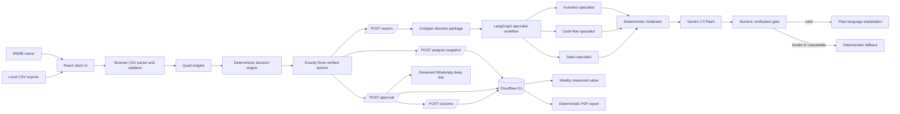
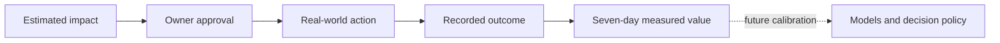

# Argus Technical Documentation

> **Purpose:** a code-accurate engineering reference for hackathon presentation and jury Q&A.
>
> **Core architecture:** **Quant predicts. Code calculates. Gemini explains. The owner decides. Reality measures.**

## Quick navigation

- [Executive summary and implementation status](#1-executive-technical-summary)
- [Architecture and complete data flow](#4-system-architecture)
- [Frontend stack](#5-frontend-stack-and-decisions)
- [Backend, database, and APIs](#6-backend-and-runtime-stack)
- [CSV ingestion and validation](#8-csv-ingestion-and-validation)
- [Forecasting, ML, and deterministic logic](#9-forecasting-and-statistical-intelligence)
- [Gemini and multi-agent design](#12-genai-and-gemini-integration)
- [Simulation, approval, WhatsApp, and outcomes](#15-human-approval-and-whatsapp-workflow)
- [Reliability, security, deployment, and scale](#18-reliability-guardrails-and-failure-behavior)
- [Trade-offs and implemented vs future](#23-major-trade-offs-and-alternatives)
- [Hackathon jury Q&A](#26-hackathon-jury-qa)
- [One-page technical cheat sheet](#27-one-page-technical-cheat-sheet)

## 1. Executive technical summary

Argus is a working-capital decision-support application for Indian distributors and MSMEs. It takes four required CSV exports—sales, inventory, receivables, and suppliers—and an optional cash-obligations file. It validates and normalizes those records in the browser, forecasts demand, detects unusual patterns, calculates inventory and cash constraints, and produces exactly three prioritized actions such as **buy**, **collect**, and **pause**.

The most important design decision is the separation of responsibilities:

- Statistical models estimate demand and identify unusual patterns.
- Deterministic TypeScript calculates quantities, cash runway, reserve protection, and financial impacts.
- LangGraph.js orchestrates parallel inventory, cash-flow, and sales interpretation nodes, deterministic moderation, Gemini explanation, and numeric verification.
- Gemini converts a compact, already-verified decision package into plain-language explanation.
- A numeric verification gate rejects Gemini text containing unsupported numbers.
- The owner must approve an action before an outcome can be recorded or a WhatsApp draft can be opened.
- Only recorded outcomes count as measured value; forecast impact remains an estimate.

The active web product is a React application built with the Next.js App Router programming model, compiled by **vinext/Vite**, and deployed as a **Cloudflare Worker/Sites** application. Original CSV files are processed in the browser and are not uploaded or persisted by the active workflow. Compact analysis snapshots, approvals, and outcomes are stored in **Cloudflare D1**.

The repository also contains a tested **FastAPI reference/portability implementation** under `services/api`. It demonstrates a Python API, pandas ingestion, NumPy calculations, and an OR-Tools optimizer, but the deployed web application does **not** call it. This distinction matters in Q&A: do not claim that OR-Tools, FastAPI, PostgreSQL, scikit-learn, or statsmodels are part of the active web request path.

## 2. Implementation status at a glance

### Implemented in the active web application

- Four required CSV uploads and one optional cash-obligations upload.
- Browser-side CSV parsing, schema checks, normalization, duplicate isolation, row quarantine, SKU coverage checks, and blocking data-quality errors.
- Per-SKU demand forecasts using model backtesting.
- Forecast-residual demand anomaly detection with explicit abstention.
- Supplier-cost intelligence using a robust Ridge-style regression and MAD ensemble, with small-data fallback and no-data abstention.
- Deterministic stock, reorder, MOQ, package-size, margin, collection, and cash-runway calculations.
- A deterministic, cash-constrained purchase allocation heuristic.
- Exactly three verified actions.
- LangGraph-orchestrated inventory, cash-flow, sales, and moderator roles over one verified package.
- Gemini explanation through a server route, with prompt constraints, numeric verification, and deterministic fallbacks.
- Deterministic what-if simulations for reserve, budget, lead time, demand, payment delay, supplier quote, and target margin.
- Immutable compact analysis snapshots in D1.
- Owner approval persistence and relationship-aware collection choices.
- WhatsApp draft and deep-link generation after approval; no automatic sending.
- Outcome persistence, idempotency, seven-day measured-value summary, and five-page PDF business report.
- Automated web/quant tests and a separate FastAPI reference test suite.

### Present in the repository but not wired into the active product

- `services/api`: a FastAPI portability/reference service with in-memory state and seeded analysis.
- OR-Tools SCIP optimization in the Python reference engine.
- `app/chatgpt-auth.ts`: helpers for reading trusted ChatGPT authentication headers and safe redirects. The current page and API routes do not call these helpers.
- Drizzle ORM schema definitions and migration generation. Runtime storage functions currently issue parameterized D1 SQL directly rather than using Drizzle query builders.

### Planned or required before production

- Real authentication and authorization on every state-changing route.
- Tenant identity derived from authentication rather than the fixed `demo-electricals` ID.
- Direct POS, ERP, accounting, UPI, bank, and GST integrations.
- Server-side upload limits, malware/content controls, audit logs, rate limiting, and retention/deletion controls.
- A dated purchase ledger for time-series supplier-cost learning.
- Background or Web Worker processing for very large files.
- Calibrated model monitoring from accumulated real outcomes.
- Production observability, alerting, retry policy, and disaster-recovery procedures.

## 3. Repository map

| Area | Important files | Responsibility |
|---|---|---|
| Product UI | `app/page.tsx`, `app/globals.css`, `app/layout.tsx` | Multi-screen user journey, state, upload controls, simulations, approvals, outcomes, and presentation |
| Quant engine | `lib/quant-engine.ts` | Demand forecasts, forecast-residual anomalies, robust supplier-cost intelligence |
| Business analysis | `lib/client-analysis.ts` | CSV parsing, validation, stock/cash calculations, prioritization, simulations, action construction |
| Agent/LLM boundary | `lib/reasoning-graph.ts`, `lib/reasoning.ts`, `app/api/reason/route.ts` | LangGraph specialist orchestration, decision-package validation/compaction, Gemini call, numeric verification, fallback explanation |
| Persistence | `db/schema.ts`, `db/argus-store.ts`, `drizzle/*.sql` | D1 tables, snapshots, approvals, outcomes, weekly aggregation |
| Product APIs | `app/api/**/route.ts` | Snapshot, explanation, approval, outcome, weekly summary, and PDF endpoints |
| Reporting | `lib/business-report.ts` | Deterministic five-page PDF report using verified data and recorded outcomes |
| Cloud runtime | `worker/index.ts`, `vite.config.ts`, `.openai/hosting.json` | Worker entry, vinext/Vite build, D1 binding, image optimization |
| Python reference | `services/api/app/*` | Alternative FastAPI contract and seeded OR-Tools reference flow |
| Verification | `tests/*`, `services/api/tests/*` | Quant, safety, API, rendering, and report checks |

## 4. System architecture

### 4.1 Active deployed architecture



### 4.2 Trust boundaries

1. **Local data boundary:** original CSV bytes are read with the browser `File` API. The active workflow does not persist the original files.
2. **Calculation boundary:** forecasts, financial calculations, and action selection run in TypeScript before any LLM request.
3. **Orchestration boundary:** LangGraph nodes may interpret only the compact verified package. They cannot mutate the browser-calculated actions, quantities, money, confidence, or evidence.
4. **LLM boundary:** only the moderated compact package is sent to Gemini.
5. **Persistence boundary:** D1 stores compact snapshots and human workflow records, not original CSV files or invented benefits.
6. **External-action boundary:** approval stores `sent = false`. The WhatsApp feature opens a pre-filled URL; it does not send a message through an API.

### 4.3 Complete data flow

1. The owner chooses four required CSV files and optionally uploads cash obligations.
2. `parseCsvFile` verifies the `.csv` extension, parses quoted cells, rejects empty files, normalizes header case, blocks duplicate headers, and checks required columns.
3. `analyzeUploads` removes exact duplicate rows and validates row-level dates, amounts, quantities, identifiers, plausible ranges, and SKU coverage.
4. Invalid rows are excluded. Critical errors—such as no usable sales, no usable inventory, invalid financial settings, or zero SKU overlap—block analysis.
5. Sales SKUs are normalized and grouped. Net demand is quantity minus returns, floored at zero.
6. `forecastDemand` builds a daily series, fills missing calendar days with zero, backtests candidate demand models, and selects the lowest-WAPE model.
7. `detectDemandAnomaly` independently checks whether the latest observed sales day falls outside a robust residual interval; it abstains when evidence is insufficient.
8. Inventory metrics combine forecast demand, usable stock, lead time, safety days, MOQ, and package size.
9. Supplier observations enter cost intelligence. With at least 30 observations, a robust Ridge + cost-ratio MAD ensemble estimates an expected range. With fewer observations it uses a declared fallback; with none it abstains.
10. Receivables receive expected dates and collection probabilities based on promised dates, overdue status, strategic relationship, and disputes.
11. `projectCashRunway` builds expected and conservative balances for 13 weeks.
12. The minimum conservative balance over the first four weeks determines immediate purchase headroom while preserving the owner-entered reserve.
13. The allocation heuristic ranks inventory needs by urgency, required units, and unit margin, then assigns affordable package-sized quantities without breaking MOQ.
14. Argus selects a reorder/hold action, a collection/abstention action, and an excess-stock pause. A sufficiently material supplier-cost finding may replace the pause as the third action.
15. A compact snapshot is saved to D1 and a compact decision package is sent to `/api/reason`.
16. LangGraph fans the fixed package out to inventory, cash-flow, and sales specialist nodes, joins them through a deterministic moderator, and then invokes the Gemini explanation node.
17. The numeric verification node accepts only supported numbers. Any incomplete response, provider failure, missing key, or unsupported output number triggers deterministic fallback text.
18. The owner opens an action, changes what-if inputs if desired, inspects evidence, and explicitly approves.
19. The server reconciles the approval with the latest stored action instead of trusting client-supplied financial values.
20. For collections, the approved workflow returns a pre-filled WhatsApp deep link. Nothing is sent automatically.
21. A real outcome can be recorded only after approval. Repeated submissions for the same action and outcome type are idempotent.
22. The seven-day summary aggregates only stored outcomes. The PDF report combines the latest snapshot with measured results.

## 5. Frontend stack and decisions

### 5.1 React 19

1. **What it is:** a component-based UI library with declarative state and rendering.
2. **Where used:** `app/page.tsx` implements the full multi-screen workflow with `useState`, `useMemo`, and `useEffect`.
3. **Why chosen:** the product has many connected states—files, analysis, selected action, simulation inputs, approval, and outcomes—that benefit from explicit reactive state.
4. **Problem solved:** keeps derived cash and simulation views synchronized with user inputs without manual DOM manipulation.
5. **Why not alternatives:** vanilla JavaScript would require more custom state orchestration; a larger client framework would add conventions not needed for this single-product workflow.
6. **Limitations/trade-offs:** `app/page.tsx` is currently a large component, and synchronous analysis runs on the main thread.
7. **Product contribution:** enables an interactive, fast, jury-friendly workflow from upload to decision to outcome.

### 5.2 TypeScript 5.9 in strict mode

1. **What it is:** statically typed JavaScript.
2. **Where used:** UI, quant engine, business analysis, APIs, database schema, worker, and tests.
3. **Why chosen:** financial and operational objects contain many fields whose accidental mismatch could create unsafe outputs.
4. **Problem solved:** catches incompatible action types, missing fields, invalid route assumptions, and calculation-shape drift at build time.
5. **Why not plain JavaScript:** runtime tests alone provide weaker protection against refactoring mistakes.
6. **Limitations/trade-offs:** types do not validate untrusted JSON at runtime; the routes therefore also perform explicit validation.
7. **Product contribution:** makes the deterministic calculation boundary easier to audit and maintain.

### 5.3 Next.js App Router programming model via vinext

1. **What it is:** the project uses Next-style `app/` pages, layouts, metadata, and route handlers; vinext compiles that model for Vite and Cloudflare Workers.
2. **Where used:** `app/layout.tsx`, `app/page.tsx`, and `app/api/*/route.ts`; scripts run `vinext dev`, `vinext build`, and `vinext start`.
3. **Why chosen:** colocates UI and server endpoints in one TypeScript project while targeting an edge runtime.
4. **Problem solved:** avoids a separate deployed API for snapshot, reasoning, approval, outcome, summary, and report operations.
5. **Why not a conventional Next.js Node server:** the target hosting environment is Cloudflare Worker/Sites. Why not a pure Vite SPA: server-only Gemini secrets and D1 operations still need trusted routes.
6. **Limitations/trade-offs:** vinext is pinned at `1.0.0-beta.2`, so it has more compatibility risk than a mature stable framework runtime.
7. **Product contribution:** gives Argus a single deployable full-stack artifact with server-rendered initial HTML and edge APIs.

### 5.4 Vite 8 and Cloudflare Vite plugin

1. **What it is:** a fast build/dev tool plus Cloudflare runtime integration.
2. **Where used:** `vite.config.ts` configures vinext, the Sites plugin, Worker environment, D1 binding, and local Wrangler/Miniflare state.
3. **Why chosen:** matches the Cloudflare deployment target and provides a modern development loop.
4. **Problem solved:** builds React Server Component/App Router output into a Worker-compatible deployment.
5. **Why not webpack:** Vite is the integration path expected by vinext and the Cloudflare plugin here.
6. **Limitations/trade-offs:** the stack combines newer components, so upgrades should be tested carefully.
7. **Product contribution:** fast local iteration and deployable edge output.

### 5.5 Tailwind CSS 4 plus custom CSS

1. **What it is:** Tailwind is imported through PostCSS, but the visible Argus UI primarily uses semantic class names and handcrafted CSS in `app/globals.css`.
2. **Where used:** `@import "tailwindcss"` and the Tailwind PostCSS plugin are configured; layouts and the premium forest/ivory design are custom CSS.
3. **Why chosen:** Tailwind supplies a modern CSS baseline/tooling while custom classes preserve a deliberate branded design and readable JSX.
4. **Problem solved:** responsive layout, focus states, consistent visual tokens, and rapid UI refinement.
5. **Why not a component library:** a generic Material/Bootstrap look would weaken product identity and add unused behavior.
6. **Limitations/trade-offs:** the custom stylesheet is large and requires disciplined maintenance; Tailwind is not heavily leveraged as utility classes.
7. **Product contribution:** makes a serious financial product feel approachable without changing the calculation logic.

### 5.6 Geist and Geist Mono

1. **What it is:** modern sans-serif and monospace fonts loaded with `next/font`.
2. **Where used:** `app/layout.tsx` defines CSS variables consumed in the stylesheet.
3. **Why chosen:** clear numerals, compact hierarchy, and a modern product tone.
4. **Problem solved:** improves readability of cash figures, labels, and technical evidence.
5. **Why not system fonts only:** system fonts vary by device and reduce visual consistency.
6. **Limitations/trade-offs:** font loading adds generated assets and must be checked in the target runtime.
7. **Product contribution:** strengthens clarity and perceived credibility.

### 5.7 Browser File API and custom CSV parser

1. **What it is:** files are read locally through `File.text()`, then parsed by a small state-machine parser supporting commas, quoted cells, escaped quotes, CRLF, and BOM removal.
2. **Where used:** `parseCsv` and `parseCsvFile` in `lib/client-analysis.ts`.
3. **Why chosen:** zero upload round-trip, no dependency, and better privacy for an MVP handling business exports.
4. **Problem solved:** turns common spreadsheet exports into normalized row objects immediately in the browser.
5. **Why not Papa Parse or server-side pandas:** Papa Parse would be more mature but adds a dependency; server parsing would upload sensitive files and add latency. pandas exists only in the Python reference service.
6. **Limitations/trade-offs:** no streaming, explicit size limit, delimiter detection, encoding detection, XLSX support, or Web Worker isolation in the active app.
7. **Product contribution:** lets small businesses use files they already export while keeping original data local.

## 6. Backend and runtime stack

### 6.1 Cloudflare Workers/Sites

1. **What it is:** an edge/serverless runtime serving application routes and assets.
2. **Where used:** `worker/index.ts`, `vite.config.ts`, and `.openai/hosting.json`.
3. **Why chosen:** low-operations deployment, globally distributed request handling, and native D1 integration.
4. **Problem solved:** hosts both the UI and trusted API boundary without managing a long-running server.
5. **Why not a traditional VM or container:** those require patching, scaling, and process management that do not strengthen the MVP.
6. **Limitations/trade-offs:** Worker runtime compatibility and execution limits differ from Node; database and external API latency still exist.
7. **Product contribution:** keeps infrastructure simple and scalable for a lightweight decision workflow.

The worker also handles `/_vinext/image` using Cloudflare image transforms. Other requests are delegated to the vinext App Router handler.

### 6.2 Route handlers and Web Fetch APIs

1. **What it is:** server endpoints are implemented as `GET`/`POST` functions returning standard `Response` or `NextResponse` objects.
2. **Where used:** all routes under `app/api`.
3. **Why chosen:** native Worker compatibility and minimal framework ceremony.
4. **Problem solved:** isolates secrets and persistence from the browser.
5. **Why not GraphQL:** the product has six small, task-specific operations and does not need arbitrary graph queries or schema tooling.
6. **Limitations/trade-offs:** validation is handwritten, and there is no generated API client or formal OpenAPI contract for active routes.
7. **Product contribution:** keeps the trust-sensitive API surface narrow and understandable.

### 6.3 `pdf-lib`

1. **What it is:** a JavaScript library for creating and editing PDF documents.
2. **Where used:** `lib/business-report.ts` generates a five-page owner report.
3. **Why chosen:** deterministic, Worker-compatible PDF generation without a browser renderer.
4. **Problem solved:** produces a portable report from the saved snapshot and measured outcomes.
5. **Why not HTML-to-PDF/Chromium:** headless Chromium is heavier and poorly suited to a Worker runtime; a reporting SaaS would expose data externally.
6. **Limitations/trade-offs:** layout and text wrapping are manual, and standard fonts limit typography.
7. **Product contribution:** gives owners a shareable artifact whose numbers do not depend on LLM output.

## 7. Database and data modeling

### 7.1 Cloudflare D1 / SQLite

1. **What it is:** Cloudflare's serverless relational database with SQLite semantics.
2. **Where used:** stores `analysis_snapshots`, `approvals`, and `outcomes` through the `DB` binding.
3. **Why chosen:** native Worker integration, relational queries, low operational burden, and adequate MVP workload.
4. **Problem solved:** persists the audit trail needed to verify approval and measured value.
5. **Why not PostgreSQL:** PostgreSQL is stronger for high-write concurrency and richer operations, but introduces a separate networked service and connection management. The active data model is small and append-oriented.
6. **Limitations/trade-offs:** regional write behavior and SQLite constraints may become limiting at high scale; current schema lacks foreign keys and unique composite constraints.
7. **Product contribution:** turns a one-time AI demonstration into a traceable decision lifecycle.

### 7.2 Drizzle ORM and migrations

1. **What it is:** a typed TypeScript ORM/schema toolkit.
2. **Where used:** `db/schema.ts`, `drizzle.config.ts`, and generated SQL migrations.
3. **Why chosen:** keeps table definitions type-readable and produces versioned SQLite migrations.
4. **Problem solved:** makes schema evolution explicit and reviewable.
5. **Why not Prisma:** Prisma is heavier and less natural in this Worker/D1 shape. Why not only handwritten SQL: schema definitions and generated migrations improve maintainability.
6. **Limitations/trade-offs:** `db/argus-store.ts` currently uses raw parameterized D1 SQL and also calls `CREATE TABLE IF NOT EXISTS`; the runtime does not use Drizzle query builders, so schema logic is duplicated.
7. **Product contribution:** provides a path toward a consistent typed persistence layer, although consolidation is future work.

### 7.3 Tables

#### `analysis_snapshots`

- `id`: UUID primary key.
- `business_id`: tenant/business partition key.
- `report_date`: analysis date.
- `snapshot_json`: compact verified analysis as JSON text.
- `created_at`: ISO timestamp.
- Indexed by `(business_id, created_at)` for latest-snapshot lookup.
- Snapshot JSON is rejected above 1,000,000 characters.

Large `demandModels` and `demandAnomalies` maps are removed before persistence. Actions, summaries, cash runway, anomaly evidence, and cost-intelligence summaries remain.

#### `approvals`

- Records business, action ID/type, optional relationship action, `sent`, and timestamp.
- `sent` defaults to false and is never set true by the current product.
- Duplicate approval requests return the existing approval.

#### `outcomes`

- Records approved action, outcome type, measured amount, notes, and timestamp.
- Duplicate `(business, action, outcome type)` submissions return the existing row.
- Weekly value sums `amount` only from rows created in the previous seven days.

### 7.4 Modeling trade-offs

- JSON snapshots preserve the exact decision context without normalizing every transient model field into tables.
- This accelerates the MVP and makes report reproduction simple.
- It sacrifices field-level querying, schema enforcement inside JSON, and efficient cross-snapshot analytics.
- Approvals and outcomes are relational because they need filtering, idempotency checks, and aggregation.
- Production should add foreign-key-like relationships, database unique constraints, explicit schema versions, and authenticated tenant IDs.

## 8. CSV ingestion and validation

### 8.1 File contract

| Dataset | Required columns |
|---|---|
| Sales | `date`, `invoice_id`, `customer_id`, `sku`, `quantity`, `selling_price` |
| Inventory | `sku`, `current_stock`, `purchase_cost`, `supplier_id` |
| Receivables | `customer_id`, `invoice_id`, `due_date`, `invoice_amount`, `outstanding_amount` |
| Suppliers | `supplier_id`, `sku`, `average_lead_time_days` |
| Cash obligations (optional) | `date`, `label`, `amount` |

Optional columns enrich the analysis, including return quantity, reserved/incoming stock, product/category names, MOQ, package size, supplier quality/on-time rate, last purchase price, expected/promised payment date, strategic flag, relationship type, and dispute flag.

### 8.2 Indian-format normalization

- SKUs are trimmed, uppercased, and normalize spaces, `/`, and `_` to `-`.
- Numeric parsing accepts currency symbols, Indian comma grouping such as `1,25,000`, percentages, whitespace, and accounting parentheses.
- Dates accept ISO format and slash/dash-separated dates. Ambiguous numeric dates default to Indian day-first order; an impossible day-first value can be safely interpreted month-first.
- Truthy business flags accept `true`, `yes`, `y`, `1`, and `strategic`.

### 8.3 Validation layers

1. **File validation:** `.csv`, at least one data row, no duplicate headers, all required columns.
2. **Duplicate isolation:** exact full-row JSON fingerprints are deduplicated before analysis.
3. **Row validation:** identifiers, dates, positive quantities/costs, non-negative balances, and plausible upper bounds.
4. **Cross-file validation:** normalized sales SKU coverage against inventory and supplier lead-time coverage.
5. **Decision-readiness validation:** analysis is blocked if core data cannot support a connected stock/demand recommendation.

Suspicious values are quarantined rather than silently coerced. Warnings disclose rejected rows, duplicate rows, date/number issues, assumed lead times, unmatched SKUs, missing obligations, and cost-model fallback/abstention.

### 8.4 Why quarantine instead of failing the entire upload

MSME exports are often imperfect. Rejecting the whole dataset because of one malformed record reduces practicality; accepting everything contaminates financial decisions. Argus therefore excludes bad rows, reports their count, and blocks only when the remaining data cannot support a safe decision.

### 8.5 Current ingestion limitations

- The active app supports CSV only, not XLSX.
- Duplicate detection finds exact rows, not semantic duplicates with slightly different formatting.
- There is no configurable column-mapping UI in the active web flow.
- There is no file-size or row-count limit enforced in `parseCsvFile`.
- Parsing and analysis are synchronous on the browser main thread.
- Generic browser date parsing is used as a final fallback and should be tightened for production.

## 9. Forecasting and statistical intelligence

### 9.1 Demand model selection

For each SKU, Argus creates a calendar-day series and fills days without recorded demand with zero. If history has fewer than 28 days, it uses a low-confidence recent moving average. Otherwise it backtests three models on a 7–14 day holdout:

#### Seasonal naive

- Repeats the last up-to-seven-day pattern.
- Appropriate for weekly demand rhythms common in distribution.
- Very explainable and robust with modest data.
- Limitation: cannot learn long trends or multiple seasonalities.

#### Simple exponential smoothing

Formula for the level:

```text
L_t = 0.35 * y_t + 0.65 * L_(t-1)
forecast = final L_t
```

- Responds to a changing recent level without a complex parameter search.
- Limitation: the implementation has no explicit trend or season component.

#### Croston's method

- Separately smooths non-zero demand size and interval, then forecasts `size / interval`.
- Appropriate for intermittent, slow-moving SKUs with many zero-demand days.
- Limitation: basic Croston can be biased and does not model promotions or covariates.

### 9.2 Model evaluation with WAPE

```text
WAPE = Σ |actual_t - forecast_t| / Σ |actual_t|
```

The model with lowest holdout WAPE is selected. WAPE was chosen because it is scale-independent, easy to explain as total absolute error relative to total demand, and stable across SKUs compared with percentage error computed per zero-demand day.

Trade-offs:

- WAPE can be dominated by high-volume periods.
- A zero total actual produces `0` in the implementation.
- It is a backtest on one recent holdout, not rolling cross-validation across many windows.

Forecast confidence is:

- Low for fewer than 28 history days.
- High when WAPE is at most 20%.
- Medium when WAPE is at most 45%.
- Low above 45%.

The 14-day interval uses a simple multiplicative spread clamped between 12% and 40% based on WAPE. It is a practical uncertainty band, not a formally calibrated probabilistic confidence interval.

### 9.3 Forecast-residual anomaly detection

Argus evaluates the latest observed positive-demand day against a model learned from earlier observed days.

Guardrails:

- Fewer than 35 observed sales days: abstain.
- Best backtest WAPE above 75%: abstain.
- Residual center uses the median.
- Residual scale uses `1.4826 × MAD`, a robust estimate of standard deviation.

```text
residual_t = actual_t - one_step_forecast_t
scale = max(1, 1.4826 × MAD(residuals))
expected = max(0, next_forecast + median_residual)
threshold = max(3, 3 × scale, 1.5 × sqrt(expected + 1))
anomaly if latest < expected - threshold or latest > expected + threshold
```

This method is suitable because it asks whether demand is unusual **relative to the selected forecast model**, not merely far from an average. MAD is resistant to previous spikes.

Limitations:

- The anomaly timeline intentionally uses observed positive-demand days rather than a full zero-filled calendar, so it detects unusual recorded sales events rather than missing-day anomalies.
- It does not establish causality.
- Thresholds are heuristic and require calibration with production outcomes.

### 9.4 Deterministic operational anomaly rules

Argus supplements ML with traceable rules:

- 14-day demand rate at least 35% above or 20% below the prior 28-day rate.
- Return rate above 12%; high severity above 25%.
- Current purchase cost above the last recorded supplier price by more than 10%; high severity above 25%.
- Negative usable stock.
- Payment over 30 days late, or over 14 days late with an amount more than 1.5 times the median overdue amount.
- Exact duplicate records.

Rules are appropriate where business meaning is direct and auditability matters more than statistical sophistication.

### 9.5 Supplier-cost intelligence

When 30 or more valid supplier-price observations exist, Argus fits a custom robust Ridge regression on log quoted cost using:

- log current product cost;
- log MOQ;
- log package size;
- normalized lead time;
- normalized quality rating;
- on-time rate.

The model solves regularized normal equations in TypeScript. The intercept is not penalized; other coefficients receive a Ridge penalty of `0.35`. It performs three iterations of robust reweighting so large residuals receive lower weight.

The regression prediction is combined conservatively with a product-cost ratio baseline. MAD bands are built around both residuals and quote/current-cost ratios. Argus uses the lower of the model and robust baseline to avoid normalizing a widespread price increase too aggressively.

A finding requires:

```text
quoted cost > expected upper bound
AND
30-day margin at risk >= materiality threshold

margin at risk = max(0, quoted cost - expected cost) × forecast 30-day units
```

The normal materiality threshold passed by the web engine is `max(INR 2,000, 2% of purchase budget)`.

Why this method:

- Ridge stabilizes a small correlated feature set.
- Log costs make relative changes more natural and prevent negative predictions after exponentiation.
- Robust reweighting and MAD reduce sensitivity to supplier-price outliers.
- The result is lightweight enough to run in a browser without an ML runtime.

Why not a deep model or gradient boosting:

- The current five-file contract contains limited features and no dated purchase history.
- More complex models would be harder to validate, explain, and justify with small MSME datasets.
- A strong model name would not compensate for missing temporal evidence.

Fallbacks and limitations:

- Fewer than 30 observations uses current cost with a ±10% range and confidence 58.
- No valid cost observations causes complete abstention.
- Holdout MAPE is reported when ML is active.
- The current supplier file is cross-sectional, not a time series; all cost findings require owner verification and confidence is capped.

## 10. Deterministic financial and inventory logic

### 10.1 Why deterministic code is mandatory

Financial actions must be reproducible. Given the same validated snapshot and settings, Argus should produce the same quantity and cash effect. Deterministic code provides:

- exact arithmetic and rounding rules;
- inspectable constraints;
- repeatable simulations;
- unit-testable safety properties;
- evidence that maps directly to source fields;
- clear failure and abstention behavior.

An LLM is probabilistic and text-oriented. It is useful for communication but is the wrong authority for reserve protection, MOQ rounding, or recorded business value.

### 10.2 Core formulas

```text
net demand = max(0, quantity - return quantity)

usable stock = current stock - reserved stock + incoming stock

safety stock = forecast daily demand × 3 days

lead-time requirement = forecast daily demand × supplier lead time

shortage = max(0, lead-time requirement + safety stock - usable stock)

rounded requirement = max(MOQ, ceil(shortage / package size) × package size)
                    when shortage > 0

days of cover = usable stock / forecast daily demand
```

The active engine uses a fixed three-day safety-stock factor. Missing supplier lead time defaults to seven days and is disclosed as an assumption.

### 10.3 Cash runway

Argus projects 13 weekly buckets from the analysis date.

For each receivable:

```text
expected inflow = outstanding amount × probability
conservative inflow = outstanding amount × max(0, probability - 0.25)
```

Probabilities are currently rule-based:

- disputed: 0;
- explicit promised date: 0.95;
- overdue without promise: 0.55;
- otherwise: 0.75.

If no promised date exists, the expected date is the due date when still future; otherwise it is 7 days after analysis for strategic customers and 10 days for others.

Weekly balances are:

```text
expected balance_w = previous balance
                   + expected inflows
                   - committed outflows
                   - proposed purchase

conservative balance_w = previous conservative balance
                       + conservative inflows
                       - committed outflows
                       - proposed purchase
```

The first week where conservative balance falls below the reserve is the shortage week. Status is:

- **At risk:** a positive reserve gap exists.
- **Watch:** no gap, but minimum conservative balance is below 120% of reserve.
- **Safe:** otherwise.

This is a scenario projection, not a bank-balance guarantee. Confidence is low when obligations are absent, medium when obligations and receivables exist, and high only when obligations exist and every receipt probability is at least 0.9.

### 10.4 Purchase capacity and allocation

Before selecting an order, Argus calculates a runway without the proposed purchase:

```text
four-week headroom = max(0,
  minimum conservative balance in weeks 1-4 - reserve)

purchasing capacity = min(owner purchase budget, four-week headroom)
```

Inventory rows are ranked by:

```text
priority score = urgency × required units × max(1, selling price - unit cost)
```

The active TypeScript workflow greedily allocates remaining cash in that order, respecting package size and MOQ. It never approves more than required and never spends above calculated purchasing capacity.

Why a heuristic instead of OR-Tools in the web path:

- It is small, transparent, deterministic, and browser-native.
- It has no WASM/server dependency.
- It is sufficient for the MVP's decision brief.
- It is not globally optimal under every combination of constraints. The Python reference demonstrates an OR-Tools SCIP formulation with budget, storage, MOQ, and package constraints, but that optimizer is not active in the deployed web product.

## 11. Action construction and prioritization

Argus always constructs exactly three verified action records because a constrained morning brief is more usable than a large alert queue.

1. **Reorder or hold:** the highest-priority shortage that can receive cash, otherwise the highest shortage or first inventory item. Impact is forecast sales protected, clearly labeled as an estimate.
2. **Collect or abstain:** overdue receivables are prioritized by strategic relationship, non-dispute status, amount, and overdue days. When no collectible balance exists, Argus explicitly abstains.
3. **Pause or cost review:** the largest excess-stock opportunity above a 45-day cover target, unless a material cost-intelligence finding outranks it.

The cost-review action replaces the pause when its 30-day margin exposure is at least `max(INR 2,000, 10% of excess-stock value)`.

Anomalies are separately ranked by severity, category priority, and confidence, then capped at 12 findings. A flag means unusual—not automatically wrong—and every finding includes detector, actual, expected, evidence, explanation, recommended check, and confidence.

## 12. GenAI and Gemini integration

### 12.1 What Gemini does

Gemini is the **Moderator explanation layer**. It receives a compact verified package and is prompted to write exactly three short plain-language sentences explaining:

- the trade-off;
- the next steps;
- owner approval and assumptions.

The default model is `gemini-2.5-flash`, configurable with `GEMINI_MODEL_ID`. The route calls Google's `generateContent` REST endpoint with temperature `0.1` and `maxOutputTokens: 600`.

### 12.2 Why Gemini

1. **What it is:** Google's general-purpose generative model API.
2. **Where used:** only `/api/reason` in the active application; the Python reference has a parallel `GeminiAdapter`.
3. **Why chosen:** fast response profile, strong summarization, simple REST integration, and sufficient quality for translating structured evidence into owner-friendly language.
4. **Problem solved:** deterministic findings can be technically correct but hard for a non-technical owner to absorb quickly.
5. **Why not OpenAI/Claude/local model:** any of these could serve the same bounded explanation role. The architecture intentionally avoids provider-specific calculation logic, so switching providers is feasible. A local model would improve data locality but add hosting and latency complexity.
6. **Limitations/trade-offs:** external availability, API cost, data leaving the application boundary, nondeterministic wording, and possible hallucination.
7. **Product contribution:** improves accessibility without becoming the numerical source of truth.

### 12.3 Why Gemini does not calculate

The LLM never chooses quantities, amounts, confidence, impacts, or actions. Letting it calculate would introduce:

- arithmetic errors;
- prompt-sensitive changes;
- poor reproducibility;
- invented assumptions;
- difficulty proving reserve safety;
- weak auditability.

Instead, Gemini receives the answer after the numerical decision is fixed. This is the meaning of **Code calculates. AI explains. Owner decides.**

### 12.4 Compact decision package

`compactDecisionPackage` includes only:

- selected quality and summary fields;
- selected cash-runway metrics and assumptions;
- at most five anomaly findings;
- aggregate demand-model evaluation metrics;
- at most three supplier-cost findings;
- role assessments;
- the three verified actions;
- selected optimizer inputs/results.

It excludes large per-SKU demand model/anomaly maps. Tests assert the package remains under 10 KB for a synthetic 2,000-SKU snapshot and excludes model payload details.

### 12.5 LLM verification and fallback

The route validates that the request contains exactly three actions and that every action has a title, reason, finite amount, and finite confidence. Non-negative amount and 0-100 confidence checks are enforced earlier by the analysis-snapshot route before persistence.

After Gemini responds:

1. Empty or very short output is rejected.
2. Every numeric token in the explanation is extracted.
3. Each number must already appear in the compact verified package.
4. Any new number causes the response to be discarded.

Fallback modes are explicit:

- `deterministic-fallback`: no API key.
- `deterministic-fallback-unverified-output`: Gemini introduced unsupported numbers.
- `deterministic-fallback-after-provider-error`: provider/network/response failure.
- `gemini`: verified provider response.

The deterministic fallback is assembled from the already-verified actions and always reminds the user that external action requires approval.

Important limitation: numeric-token verification prevents invented numbers, but it does not prove that Gemini associated an allowed number with the correct concept. The constrained prompt, short format, low temperature, and human review reduce this risk; a future structured-output schema and semantic claim verifier would strengthen it further.

## 13. Multi-agent architecture

### 13.1 What “multi-agent” means in the implemented product

Argus now uses **LangGraph.js** to orchestrate multiple specialist nodes over one compact, verified decision package. It remains a controlled workflow rather than a swarm of autonomous chatbots:

| Graph node | Responsibility | Implemented authority |
|---|---|---|
| Inventory specialist | Interprets the verified reorder action and stock constraints | Read-only interpretation; cannot recalculate or change the action |
| Cash-flow specialist | Interprets the verified runway, reserve, and purchasing boundary | Read-only interpretation; cannot alter cash or quantity |
| Sales specialist | Interprets the verified collection priority and customer context | Read-only interpretation; cannot send or approve a message |
| Deterministic moderator | Joins the three parallel branches and preserves the fixed three-action package | May assemble specialist context; cannot change actions |
| Gemini explainer | Converts the moderated package into concise owner language | Explanation only |
| Numeric verification gate | Rejects explanations containing numbers absent from the package | May accept verified text or select deterministic fallback |

The active graph is implemented in `lib/reasoning-graph.ts` and invoked behind the existing `/api/reason` endpoint. The frontend flow and response contract remain unchanged.

### 13.2 Why role separation is still valuable

- Working-capital decisions are inherently cross-functional.
- Inventory alone would over-order to avoid stockouts.
- Cash flow alone would under-order to preserve liquidity.
- Sales alone would prioritize revenue without respecting reserve or supplier constraints.
- Separate role outputs make the conflict visible and explain why the final order can be smaller than the inventory requirement.

### 13.3 Why not a single LLM agent

A single LLM would blur prediction, financial authority, prioritization, and explanation. Argus instead uses typed LangGraph state, deterministic financial modules, read-only specialist nodes, and one tightly constrained explanation call. This keeps every amount reproducible while making orchestration explicit and testable.

### 13.4 What happens when agents disagree

They do not vote. Deterministic constraints resolve the disagreement before LangGraph runs:

1. Inventory calculates unconstrained need.
2. Cash flow calculates safe capacity and reserve constraints.
3. Sales supplies value/urgency signals.
4. The allocation function applies those constraints and ranks opportunities.
5. LangGraph specialists interpret the same fixed output in parallel.
6. The deterministic moderator joins their interpretations and Gemini explains the existing compromise.

For example, inventory may require 80 units while cash can fund only 60. The output is 60 now, the remainder deferred, plus a collection action that could unlock more cash. Gemini cannot override this result.

### 13.5 Trade-off

The technically precise description is **a LangGraph-orchestrated, role-based decision workflow with deterministic financial authority and an LLM explanation node**. LangGraph provides explicit state and graph execution, but Argus deliberately does not give specialist nodes open-ended tool access, independent memory, or permission to modify financial outputs. This is safer and easier to test than autonomous agent negotiation.

### 13.6 Why the graph does not checkpoint or interrupt the current UI

The existing product already separates explanation from owner approval: `/api/reason` returns verified wording, while `/api/approvals` and D1 provide the durable human-control boundary. Adding a LangGraph interrupt would require a new resumable frontend/API contract and would change the present user flow. The implemented graph therefore completes within `/api/reason`; D1 continues to persist snapshots, approvals, and outcomes. A future connected-accounting workflow could add a durable graph checkpointer when long-running execution is genuinely required.

## 14. API design

### 14.1 Active endpoints

| Endpoint | Method | Purpose | Key safety behavior |
|---|---|---|---|
| `/api/analysis-snapshots` | POST | Save latest verified compact analysis | Requires analysis-ready snapshot with exactly three valid actions |
| `/api/reason` | POST | Run the specialist graph and explain the verified package | LangGraph fans out read-only specialist nodes, joins them deterministically, constrains Gemini, rejects unsupported numbers, and falls back safely |
| `/api/approvals` | POST | Record owner approval | Reconciles action against latest snapshot; collection requires approved relationship approach |
| `/api/outcomes` | POST | Record real result | Requires latest verified action and prior approval; validates non-negative amount |
| `/api/weekly-summary` | GET | Aggregate seven-day outcomes and approval metrics | Counts only stored records; autonomous action count comes from `sent` |
| `/api/business-report` | GET | Generate deterministic PDF | Uses latest saved snapshot and weekly outcomes; `private, no-store` response |

### 14.2 Frontend-backend communication

- `fetch` with JSON is used for all state-changing APIs.
- PDF download uses a Blob and a temporary object URL.
- The application currently uses the literal business ID `demo-electricals` in client requests.
- Route validation is manual and returns 400 for malformed input, 404 for missing reports, 409 for stale/unverified workflow state, and 500 for storage/generation failures.
- The frontend converts failures into user-visible retry or fallback states rather than exposing stack traces.

### 14.3 Why REST-style routes

The operations are commands and small summaries with clear trust boundaries. REST-style handlers are easy to inspect, test, cache-control, and call from the browser. GraphQL or an event bus would add complexity without improving the MVP.

### 14.4 Current API limitations

- No version prefix on active web routes.
- No shared runtime schema library such as Zod.
- No OpenAPI generation.
- No request ID, rate limiting, audit event stream, or structured error codes.
- No concurrency/version token preventing approval against an analysis replaced between UI display and request, beyond checking the latest snapshot for the action ID/type.
- The PDF route currently hard-codes the display name `Mehra Electricals`; business profile data is not yet modeled.

## 15. Human approval and WhatsApp workflow

### 15.1 Approval flow

1. The analysis snapshot must already be stored.
2. The UI submits business ID, action ID, action type, and—only for collections—a relationship approach.
3. The server loads the latest snapshot and finds the action by ID.
4. The action type must match the stored verified action.
5. The server ignores the client-supplied amount and uses the stored action amount.
6. Approval is stored once; repeated requests return the existing row.
7. `sent` remains false.

Collection approaches allowed by the active route are `friendly`, `payment-date`, `formal`, and `call`.

### 15.2 WhatsApp draft generation

After collection approval, the server creates a fixed, professional draft containing the verified outstanding amount. It returns:

- the draft text;
- a `https://wa.me/?text=...` deep link.

The user must click the link and review/send in WhatsApp. There is no WhatsApp Business API integration, recipient phone number, delivery confirmation, or automatic message sending.

Why this design:

- preserves relationship judgment;
- avoids accidental or unauthorized collection messages;
- provides immediate practical value without requiring WhatsApp platform onboarding;
- keeps `autonomousActions` at zero.

Limitation: the draft template currently does not vary with the selected relationship approach, and the deep link does not target a specific phone number.

## 16. What-if simulation architecture

Simulations are local, deterministic, and non-mutating. React `useMemo` recalculates derived values when inputs change.

### 16.1 Reorder simulation

Inputs include reserve, budget, lead time, demand multiplier, unit cost, package size, MOQ, and required units.

```text
adjusted need = package-rounded(
  base required units
  × demand multiplier
  × new lead time / base lead time)

spendable = max(0, min(budget, available cash - reserve))

affordable packages = floor(spendable / (unit cost × package size))

approved units = min(adjusted need, affordable packages × package size)
```

If the result is below MOQ, approved units become zero.

### 16.2 Cash simulation

Payment delay shifts expected receipt dates without mutating the saved source inputs. The 13-week runway is recalculated with the simulated purchase and delay.

### 16.3 Cost/margin simulation

For a cost-control action:

```text
simulated quote = base unit cost × quote percentage

minimum selling price = simulated quote / (1 - target margin percentage)

30-day margin exposure = max(0, simulated quote - expected cost)
                       × forecast daily demand × 30
```

### 16.4 Why simulations do not retrain models

The question is “what happens if this business assumption changes?”, not “what new pattern does the historical model learn?” Keeping the trained forecast fixed isolates the causal effect of the changed constraint and produces immediate, reproducible feedback.

Limitations:

- Simulations model a bounded set of variables.
- They do not run Monte Carlo scenarios or estimate correlated uncertainty.
- They are not saved as separate scenario versions.

## 17. Outcome tracking and feedback loop

Argus deliberately separates **estimated impact** from **measured value**.



Implemented today:

- Outcome types: stockout avoided, payment received, purchase avoided, margin protected, and other.
- A non-negative measured amount and optional note.
- Prior approval requirement.
- Reconciliation with the latest verified action.
- Idempotency by business, action, and outcome type.
- Seven-day totals and category counts.
- PDF reporting of measured value and autonomous action count.

Not implemented today:

- Automatic reconciliation against bank/POS/ERP evidence.
- Attribution logic proving that Argus caused the result.
- Feeding outcomes back into forecast training.
- Model drift or calibration dashboards.

The feedback loop is therefore **recorded and reportable**, but not yet an automated learning loop.

## 18. Reliability, guardrails, and failure behavior

### 18.1 Guardrail layers

1. Required-column and file checks.
2. Row quarantine and plausible-value limits.
3. Cross-file SKU coverage gate.
4. Low-history forecast confidence.
5. ML abstention thresholds.
6. Deterministic reserve, budget, MOQ, and package constraints.
7. Exactly-three-action contract.
8. Compact LLM payload.
9. Low-temperature prompt with explicit prohibition on new quantities/actions.
10. Numeric output verification.
11. Deterministic LLM fallback.
12. Latest-snapshot reconciliation before approval/outcome.
13. Human approval before any external draft or outcome.
14. Idempotent approval and outcome storage.
15. Measured-value reporting only from recorded outcomes.

### 18.2 Failure matrix

| Failure | Behavior |
|---|---|
| Empty/wrong CSV | Upload rejected with specific error |
| Some invalid rows | Rows quarantined; warnings shown |
| No usable core data or zero SKU match | Analysis blocked |
| Missing lead time | Seven-day assumption disclosed |
| Missing obligations file | Runway confidence reduced and warning shown |
| Short demand history | Low-confidence moving average |
| Weak anomaly model | Abstains rather than flags |
| Too few supplier prices | Low-confidence deterministic fallback |
| No supplier prices | Cost ML abstains |
| Zero purchase budget | Cash-safe hold action with amount zero |
| Gemini key absent | Deterministic explanation |
| Gemini/API failure | Deterministic explanation |
| Gemini invents a number | Output rejected; deterministic explanation |
| D1 unavailable during snapshot save | UI exposes retry/error state; analysis remains visible locally |
| Approval references stale/unverified action | HTTP 409 |
| Outcome has no approval | HTTP 409 |
| Duplicate approval/outcome | Existing record returned; value not inflated |
| PDF requested before analysis | HTTP 404 |

### 18.3 Error-handling limitations

- Server routes often catch all exceptions and return a generic message, which is safe for users but weak for operational diagnosis.
- Errors are logged only for Gemini fallback; there is no centralized telemetry.
- There are no retry queues for D1 or Gemini.
- The UI uses a timed progress animation; it does not reflect individually instrumented pipeline stages.

## 19. Authentication, security, and privacy

### 19.1 Implemented protections

- Gemini API key stays in the server environment, never in browser code.
- D1 queries use bound parameters.
- Original CSV files remain browser-local in the active workflow.
- Persisted snapshots are compact and capped at one million JSON characters.
- State-changing routes validate action types, outcomes, amounts, and workflow order.
- Approval values are reconciled from the stored snapshot.
- External messages are not sent automatically.
- Report responses use `Cache-Control: private, no-store`.
- WhatsApp links are URL-encoded and opened with `rel="noreferrer"` in the UI.
- TypeScript strict mode, ESLint, React Hooks rules, accessibility linting, and tests reduce implementation errors.

### 19.2 Authentication reality

`app/chatgpt-auth.ts` correctly reads platform-provided authenticated-user headers and implements safe relative redirects. However, no page or API route imports it. Therefore:

- authentication is **not enforced** by the current application code;
- the UI and routes use a fixed demo business ID;
- user isolation must not be claimed as production-ready;
- a caller could supply another `businessId` unless the hosting layer independently restricts access.

The Python reference accepts an `X-Business-ID` header and isolates in-memory runs by it, but this is not authentication.

### 19.3 Production security work

Before real customer data:

- require an authenticated user on every page and route;
- derive tenant/business ID server-side from membership, never from request JSON;
- add role-based authorization for analysis, approval, and reporting;
- add CSRF protection where platform defaults do not cover the route;
- enforce request/file size and row limits;
- rate-limit Gemini and write endpoints;
- add audit logs, retention/deletion controls, secret rotation, and incident monitoring;
- document data-processing agreements and regional data flow for Gemini;
- encrypt sensitive data according to platform capabilities and business requirements;
- avoid sending customer names or invoice identifiers to an LLM unless consent and policy allow it, or pseudonymize them;
- validate formulas and access controls through independent security review.

## 20. Deployment and infrastructure

### 20.1 Active deployment path

```text
npm run build
  -> vinext build
  -> Vite + React/RSC compilation
  -> Cloudflare Worker bundle and assets
  -> Worker handles app/API requests
  -> D1 binding named DB stores workflow state
```

Runtime configuration:

- Node engine for development/build: `>=22.13.0`.
- Worker compatibility flag: `nodejs_compat`.
- D1 binding: `DB` from `.openai/hosting.json`.
- R2: not configured.
- `GEMINI_API_KEY`: optional; absence activates deterministic fallback.
- `GEMINI_MODEL_ID`: optional; defaults to `gemini-2.5-flash`.
- `NEXT_PUBLIC_SITE_URL`: optional metadata base.

### 20.2 Local development

```powershell
npm install
Copy-Item services\api\.env.example .env.local
npm run dev
```

The optional Python reference requires Python 3.12 and its own dependencies.

### 20.3 Python reference deployment

`services/api/Dockerfile` runs Uvicorn on port 8000. The reference API holds uploads, runs, approvals, and outcomes in process memory, so it is not horizontally scalable or durable as written. Its `.env.example` mentions PostgreSQL and IBM COS, but the current Python code does not connect to either service.

## 21. Scalability and performance

### 21.1 What scales well today

- Static assets and route execution use a serverless edge platform.
- Original file parsing avoids upload bandwidth and server compute.
- Calculations are linear or near-linear for common operations.
- D1 indexes latest snapshots and seven-day records by business and timestamp.
- LLM payload compaction prevents sending per-SKU model maps.
- Reports use saved compact snapshots rather than recomputing from original files.

### 21.2 Complexity profile

- CSV parse: approximately `O(characters)`.
- Exact duplicate isolation: `O(rows)` average with hash sets.
- Per-SKU grouping: `O(rows)`.
- Sorting sales within each SKU: total up to `O(n log n)`.
- Forecast backtests: linear in history for each model.
- Allocation and anomaly ranking: `O(SKUs log SKUs)`.
- Ridge solve: small fixed feature matrix; observation processing is effectively linear, while the matrix solve is constant-sized.

### 21.3 Bottlenecks

- Main-thread parsing and analysis can make the UI unresponsive on very large exports.
- `JSON.stringify(row)` duplicate fingerprints allocate memory proportional to row width.
- Analysis snapshots are append-only; retention is not managed.
- `ensureSchema` issues `CREATE TABLE IF NOT EXISTS` statements from runtime storage calls.
- Weekly aggregation and latest-snapshot queries are simple today but need pagination/retention at larger tenant volumes.
- Gemini is an external latency and quota dependency, although it is non-critical because of fallback.

### 21.4 Scaling path

1. Move parsing/forecasting to Web Workers for medium-sized local datasets.
2. Add streaming CSV parsing and explicit resource limits.
3. For very large tenants, upload encrypted files to controlled object storage and run asynchronous jobs.
4. Normalize snapshot analytics into queryable tables or a warehouse while keeping immutable decision records.
5. Add tenant-aware queues, idempotency keys, and cached reports.
6. Replace runtime schema creation with managed migrations.
7. Add observability for validation rates, model coverage/WAPE, abstentions, provider fallback, latency, and approval/outcome conversion.
8. Introduce a true optimizer only when constraint complexity or portfolio size justifies it.

## 22. Testing and evaluation

### 22.1 Active automated coverage

Verification performed against the documented codebase: the production web build completed, the server-render check passed, all 22 TypeScript web/quant tests passed, ESLint passed, and all 13 tests for the optional Python reference passed.

The Node test command first builds the application, checks server-rendered HTML, and runs TypeScript test files. Tests cover:

- Indian number/date/SKU normalization.
- Empty CSV, missing columns, duplicate headers, invalid rows, and zero SKU coverage.
- Duplicate isolation.
- Three-action generation.
- Cash-constrained hold behavior.
- MOQ/package rounding.
- Deterministic what-if changes.
- Thirteen-week reserve breach and payment-delay effects.
- Demand model selection and forecast intervals.
- Short-history low confidence.
- Planted demand spike detection and normal-series non-detection.
- Demand-anomaly abstention.
- Robust cost anomaly detection and small-data fallback.
- Compact LLM/report payloads.
- Exactly-three-action validation.
- Rejection of unsupported Gemini numbers.
- Deterministic reasoning fallback.
- Five-page PDF generation.
- Server-rendered product HTML.

The Python suite separately tests forecast/optimizer behavior, API isolation, approval requirements, and Gemini fallback. These validate the reference service, not the deployed path.

### 22.2 How to evaluate accuracy properly

Forecast accuracy:

- rolling-origin WAPE by SKU and demand class;
- bias: `Σ(forecast - actual) / Σ actual`;
- interval coverage: percentage of actual values inside predicted bounds;
- results segmented by history length, intermittency, and seasonality.

Anomaly quality:

- precision/recall against owner-confirmed unusual events;
- false-positive rate per SKU/week;
- abstention rate and performance when not abstaining.

Decision quality:

- reserve breaches avoided;
- service level/stockout rate;
- inventory days and excess capital;
- cash conversion and overdue days;
- comparison with a transparent baseline policy, not only before/after totals.

LLM quality:

- unsupported-number rejection rate;
- factual consistency against action fields;
- readability and owner comprehension;
- provider failure/fallback rate;
- human correction rate.

Business impact:

- use bank/POS/ERP evidence where possible;
- report forecast impact separately from realized outcomes;
- use matched pilots or phased rollout to avoid claiming correlation as causation.

## 23. Major trade-offs and alternatives

| Decision | Chosen approach | Obvious alternative | Why chosen now | Cost/trade-off |
|---|---|---|---|---|
| Calculation location | Browser TypeScript | Server batch engine | Privacy, low latency, no compute service | Main-thread and device limits |
| Forecasting | Small backtested model set | Prophet/deep learning | Explainable and appropriate for limited data | Less expressive seasonality/covariates |
| Demand anomaly | Robust forecast residual | Isolation Forest/deep anomaly model | Time-aware, auditable, can abstain | Heuristic thresholds |
| Cost model | Robust Ridge + MAD | Gradient boosting/neural model | Small data, browser-native, explainable | Limited nonlinear relationships |
| Purchasing | Greedy constrained heuristic | MILP/OR-Tools | Transparent, lightweight web path | Not globally optimal |
| Explanation | Gemini after verification | LLM generates actions | Human-friendly text without numerical authority | External dependency and semantic risk |
| Agent design | Role-based modules | Autonomous multi-agent LLM framework | Deterministic conflict resolution | Less open-ended reasoning |
| Storage | D1 + JSON snapshots | PostgreSQL normalized model | Native serverless integration and fast MVP | Limited analytics/concurrency |
| Reporting | `pdf-lib` | Headless browser/report SaaS | Deterministic and Worker-compatible | Manual layout |
| Messaging | WhatsApp deep link | WhatsApp Business API | Owner control and easy MVP | No delivery automation/status |
| Input integration | CSV exports | Live ERP/bank connectors | Broad compatibility and fast onboarding | Manual and stale snapshots |

## 24. Why the architecture fits Indian MSMEs

- **Works with existing exports:** owners do not need to replace their billing or accounting tool.
- **Handles Indian formats:** rupee symbols, lakh-style comma grouping, day-first dates, and inconsistent SKU separators.
- **Protects scarce cash:** reserve safety is a hard calculation, not a conversational suggestion.
- **Accounts for payment uncertainty:** overdue money is probability-weighted rather than treated as cash in hand.
- **Respects supplier reality:** lead time, MOQ, and package size affect the approved order.
- **Preserves relationships:** strategic/disputed collections require owner-chosen follow-up.
- **Produces only three actions:** the output is designed for a busy owner, not an analyst dashboard.
- **Works without AI availability:** the numerical product remains functional when Gemini is absent.
- **Can start lightweight:** CSV and deep links avoid an expensive integration project during adoption.
- **Creates evidence for future integration:** immutable snapshots, approvals, and outcomes establish the data lineage needed for connected systems later.

The main caution is that real MSME adoption requires stronger authentication, consent, multilingual support, mobile optimization, integration reliability, and assisted onboarding than the current MVP provides.

## 25. Implemented versus future architecture

| Capability | Current status | Accurate jury wording | Future direction |
|---|---|---|---|
| CSV analysis | Implemented | “Argus reads five common exports; four are required.” | XLSX, mapping, streaming, connectors |
| Forecasting | Implemented | “Three simple models are backtested per SKU and the lowest-WAPE model is selected.” | Rolling validation, richer seasonality/covariates |
| ML cost intelligence | Implemented with limitations | “A browser-native robust model flags cross-sectional supplier-cost outliers and abstains/falls back on weak data.” | Dated purchase ledger and calibrated time-series model |
| Cash runway | Implemented | “Thirteen-week expected and conservative balances protect the reserve.” | Bank reconciliation and probabilistic calibration |
| Purchase optimizer | Greedy heuristic in active web | “The current web app uses deterministic constrained allocation.” | MILP/OR-Tools when constraints justify it |
| Multi-agent | Role-based pipeline | “Specialist roles share one verified snapshot; code resolves conflicts.” | Separate services only if scale/organizational need appears |
| Gemini | Implemented for explanation | “Gemini explains fixed numbers; it cannot change actions.” | Structured output and semantic claim verification |
| Approval | Implemented | “Approvals are stored and actions are rechecked against the latest snapshot.” | Identity, roles, signatures, complete audit trail |
| WhatsApp | Draft/deep link only | “Argus prepares a reviewed draft; the owner sends it.” | Official API with explicit consent and delivery state |
| Outcomes | Implemented manual recording | “Only owner-recorded real outcomes count as measured value.” | Automatic evidence reconciliation and causal evaluation |
| Authentication | Helper only, not enforced | “Authentication is not complete in this MVP.” | Server-derived tenants and RBAC |
| Deployment | Cloudflare Worker/Sites + D1 | “The active web app is an edge/serverless deployment.” | Production monitoring, backups, regional policy |
| Python API | Reference only | “FastAPI/OR-Tools are tested portability work, not the live web path.” | Possible service extraction for heavy workloads |

## 26. Hackathon jury Q&A

### Q1. What is the architecture in one answer?

Argus is a browser-first decision system. CSV files are validated and analyzed locally; statistical models estimate demand and unusual patterns; deterministic TypeScript protects cash, applies stock constraints, and creates three actions; LangGraph orchestrates specialist interpretation, deterministic moderation, Gemini wording, and numeric verification; D1 stores snapshots, approvals, and outcomes; the owner controls every external action.

### Q2. Why use a multi-agent architecture?

Because working-capital decisions contain real conflict. Inventory wants enough stock, cash flow protects liquidity, and sales protects revenue. LangGraph runs those specialist interpretations as explicit parallel nodes over the same verified package, then joins them through a deterministic moderator. They are not autonomous chatbots: code has already calculated and fixed the actions before the graph begins.

### Q3. Why not use a single LLM?

A single LLM would mix arithmetic, business rules, prioritization, and explanation in one probabilistic component. We separate them so financial outputs are reproducible and testable. Gemini sees only the already-decided package and cannot change quantities or money.

### Q4. Why Gemini?

Gemini 2.5 Flash offers a fast and straightforward REST API for concise explanation. It is a presentation layer, not a dependency of the numeric engine. The integration is provider-replaceable because the contract is a compact JSON decision package and verified text response. If Gemini fails or is not configured, Argus continues with deterministic explanation.

### Q5. Where exactly is ML used?

First, per-SKU demand forecasting backtests seasonal naive, exponential smoothing, and Croston models and selects the lowest-WAPE model. Second, demand anomaly detection tests the latest observed day against robust forecast residuals. Third, supplier-cost intelligence uses robust Ridge regression plus MAD bands when at least 30 price observations exist. Inventory quantities, cash runway, action amounts, and outcome totals are deterministic formulas, not ML.

### Q6. Is the cost model really machine learning if it is coded without scikit-learn?

Yes. Ridge regression is a supervised statistical learning model regardless of library. The active version directly solves regularized normal equations and adds robust reweighting. Avoiding an ML runtime makes it browser-native and auditable. scikit-learn is listed only in the Python reference service requirements and is not used by the active TypeScript model.

### Q7. Why not let the LLM calculate everything?

Because financial safety requires repeatability. An LLM can make arithmetic errors, change with wording, or invent assumptions. Code can enforce `approved spend ≤ budget`, preserve the reserve, apply MOQ/package rounding, and return the same answer for the same snapshot. The LLM's comparative advantage is clear language.

### Q8. How do you prevent hallucinations?

We minimize the space in which hallucination can matter. Gemini receives a compact verified package, is told not to invent actions or figures, runs at temperature 0.1, and must return a short format. Then Argus extracts every output number and checks that it already exists in the package. Unsupported numbers, incomplete output, or provider errors trigger deterministic fallback. The owner still reviews the explanation.

### Q9. How do you verify AI-generated recommendations?

Strictly speaking, Gemini does not generate the recommendations. Deterministic code generates the three actions. Gemini generates only explanation. The server validates the package and the numeric content of the explanation. Approval is then reconciled against the latest stored action.

### Q10. Can Gemini misuse a number that exists elsewhere in the package?

That is a current limitation. Numeric gating blocks new numbers but is not a full semantic proof. We reduce the risk with a short constrained prompt, compact fields, low temperature, deterministic fallback, and human review. The next improvement would be structured output with field-level references and a semantic claim verifier.

### Q11. How does Argus handle messy data?

It validates in layers: file structure, required columns, duplicate headers, exact duplicate rows, Indian number/date formats, plausible ranges, and cross-file SKU coverage. Bad rows are quarantined and counted. Missing lead times use a disclosed seven-day assumption. If the remaining data cannot connect demand to inventory, analysis is blocked rather than guessed.

### Q12. How is financial safety maintained?

Receipts are probability-weighted, then reduced by another 25 percentage points in the conservative scenario. Committed obligations and the proposed order are subtracted over 13 weeks. Immediate purchase capacity is capped by both the owner's budget and the minimum first-four-week conservative balance above the protected reserve. Quantities also obey package size and MOQ.

### Q13. What happens if the AI or API fails?

The full numeric workflow still works. Missing Gemini configuration, provider errors, incomplete output, or unsupported numbers all return a deterministic explanation. If D1 fails, the local analysis remains visible, but approval, outcome persistence, and report generation cannot complete until storage recovers.

### Q14. What happens when specialist agents disagree?

They do not negotiate through prose or vote. Inventory need, cash capacity, and sales priority are resolved by deterministic allocation first. LangGraph then lets each specialist interpret that result independently and joins the branches before explanation. The moderator cannot override the code-calculated compromise—for example, a partial order now plus collection to unlock the deferred amount.

### Q15. What makes Argus different from an ERP or dashboard?

An ERP records transactions and a dashboard displays metrics. Argus connects sales, stock, receivables, supplier terms, and obligations into three cross-functional actions under a cash-reserve constraint. It also shows evidence, supports simulation, requires approval, and records what actually happened.

### Q16. What makes it different from a generic chatbot?

A chatbot answers from a prompt. Argus has a validated data contract, backtested models, deterministic financial formulas, hard operational constraints, verified actions, an LLM output gate, persistent approval, and outcome measurement. Conversation is not the system of record.

### Q17. How would real POS, ERP, UPI, bank, or GST data connect?

Each connector would map source events into the existing canonical datasets: sales lines, stock positions, receivables/payment promises, supplier terms/purchase history, and dated cash obligations. An ingestion layer would authenticate, incrementally sync, deduplicate by source IDs, record watermarks, and produce versioned snapshots. The decision engine can remain mostly unchanged because it consumes normalized records rather than vendor-specific APIs.

### Q18. How is user data protected?

In the MVP, original CSVs stay in the browser and the Gemini key stays server-side. D1 queries are parameterized, LLM payloads are compact, and reports are non-cacheable. However, authentication is not currently enforced and the demo uses a fixed business ID. We would not call the MVP production-secure until server-derived tenant identity, RBAC, rate limits, retention, audit logs, and privacy controls are implemented.

### Q19. Does Argus send WhatsApp messages automatically?

No. After owner approval, it generates a draft and opens a pre-filled WhatsApp deep link. `sent` remains false, and the weekly summary reports zero autonomous actions. Official API sending is future scope and would still require explicit permission and auditability.

### Q20. How does the system scale?

The edge routes and D1 remove server management, while browser processing avoids upload compute. Payload compaction and indexed tenant/timestamp queries keep the MVP light. For larger data, we would move parsing to Web Workers, add streaming and limits, then use asynchronous server jobs and object storage for very large tenants. D1 can later be supplemented by normalized analytics storage.

### Q21. Why use D1 instead of PostgreSQL?

D1 is native to the Worker runtime and fits a small append-oriented audit trail without connection infrastructure. PostgreSQL becomes attractive for high concurrency, richer constraints, and analytical queries. The repository's Python `.env.example` mentions PostgreSQL, but no PostgreSQL connection is implemented.

### Q22. Are you using OR-Tools?

Not in the active web workflow. The deployed TypeScript engine uses a deterministic greedy allocation that respects budget, reserve, package size, and MOQ. OR-Tools SCIP is implemented and tested in the separate Python reference engine. We would move to MILP when the live constraint set—multiple warehouses, supplier tiers, storage, service levels—justifies the extra runtime complexity.

### Q23. How would you evaluate the system's accuracy?

We would track rolling WAPE, bias, and interval coverage by SKU; precision/recall and false positives for owner-confirmed anomalies; reserve breaches, stockouts, inventory days, and cash conversion for decisions; and unsupported-number, correction, and fallback rates for Gemini. Business impact must use recorded evidence and a baseline or controlled rollout, not forecast claims alone.

### Q24. What are the biggest MVP limitations?

Authentication is not wired in; the business ID is fixed in the UI; CSV parsing is main-thread and has no explicit size limit; supplier-cost data lacks a dated purchase ledger; receipt probabilities and thresholds are heuristic; the allocation is greedy rather than globally optimal; outcome entry is manual; and LLM verification is numeric rather than fully semantic.

### Q25. What would you build next?

First, production identity and tenant security. Second, direct accounting/POS/bank ingestion with a dated purchase ledger. Third, Web Worker/streaming performance. Fourth, structured Gemini output with field-level evidence verification. Fifth, outcome reconciliation and calibrated model monitoring. Only after those foundations would we add more autonomous integrations—and external execution would remain explicitly approved.

### Q26. Why is the forecast not a complex deep-learning model?

The current data volume and feature set do not justify one. Seasonal naive, exponential smoothing, and Croston cover weekly, level, and intermittent demand patterns; backtesting selects the best for each SKU. They are explainable and can abstain. A complex model without promotions, holidays, or long history would add opacity more reliably than accuracy.

### Q27. Is the 13-week runway a prediction?

It is a deterministic scenario projection built from supplied obligations and probability-weighted receipt assumptions. It shows both expected and more conservative paths. It does not claim to predict unexpected expenses or guarantee collection. Missing obligations reduce confidence and generate a warning.

### Q28. How do you stop stale or manipulated approvals?

The server ignores client-supplied financial amounts and loads the action from the latest stored snapshot. The action ID and type must match or the server returns 409. A production version should additionally use an explicit snapshot/version ID and authenticated tenant identity to eliminate remaining race and identity risks.

### Q29. Why exactly three actions?

It is a product constraint, not an algorithmic necessity. MSME owners need a short morning decision brief. Three actions force prioritization and map to the central working-capital levers: protect availability, release receivables, and avoid or review low-value spend. Detailed anomalies remain available as evidence rather than becoming a feature dump.

### Q30. What is the single strongest engineering principle?

**The model may estimate uncertainty, but only deterministic code can authorize a financial number—and only the owner can authorize an external action.**

## 27. One-page technical cheat sheet

### Memorize this architecture

```text
CSV files
  -> browser validation and Indian-format normalization
  -> per-SKU statistical forecasts and anomaly checks
  -> deterministic stock + cash + allocation logic
  -> exactly three verified actions
  -> compact package to Gemini for explanation only
  -> numeric output gate or deterministic fallback
  -> owner approval
  -> recorded outcome and weekly measured value
```

### Active stack

- **Frontend:** React 19, TypeScript 5.9 strict, Next App Router model, vinext, Vite 8, custom CSS/Tailwind 4 tooling, Geist.
- **Runtime:** Cloudflare Worker/Sites.
- **Database:** Cloudflare D1/SQLite; Drizzle schema and migrations; runtime parameterized D1 SQL.
- **AI:** Gemini 2.5 Flash by REST, explanation only.
- **Agent orchestration:** LangGraph.js `StateGraph`, with parallel specialist nodes and a deterministic join; no autonomous financial tools.
- **Reports:** `pdf-lib`, deterministic five-page PDF.
- **Tests:** Node test runner + TypeScript tests; separate pytest suite for the Python reference.
- **Not active:** FastAPI, OR-Tools, PostgreSQL, scikit-learn, and statsmodels are not in the deployed web path.

### Key formulas

```text
WAPE = Σ|actual - forecast| / Σ|actual|

usable stock = current - reserved + incoming

shortage = max(0,
  forecast/day × lead time
  + forecast/day × 3 safety days
  - usable stock)

order = package-rounded shortage, respecting MOQ

conservative receipt = amount × max(0, probability - 0.25)

purchase capacity = min(
  owner budget,
  minimum conservative balance in weeks 1-4 - reserve)

margin at risk = max(0, quoted cost - expected cost)
               × 30-day forecast units
```

### Model logic

- Fewer than 28 history days: low-confidence moving average.
- Otherwise backtest seasonal naive, exponential smoothing, and Croston; select lowest WAPE.
- Demand anomaly needs at least 35 observed sales days and WAPE no higher than 75%; otherwise abstain.
- Cost ML needs at least 30 valid observations; otherwise transparent fallback; no prices means abstain.
- Robustness uses median and `1.4826 × MAD`.

### Safety answers

- **Why not LLM math?** Reproducibility, hard constraints, tests, and auditability.
- **How prevent hallucination?** Compact verified input, low temperature, no-new-number gate, fallback, human review.
- **If Gemini fails?** All calculations and actions remain; deterministic explanation is returned.
- **When agents disagree?** Code applies cash/reserve constraints first; LangGraph specialists interpret the fixed result and do not vote.
- **Does WhatsApp auto-send?** No. Draft/deep link only after approval; `sent = false`.
- **Is impact measured?** Forecast impact is labeled estimate; only recorded outcomes enter weekly value.
- **Is authentication complete?** No. Helper exists but is not wired; fixed demo tenant is an MVP limitation.
- **Is OR-Tools live?** No. It is only in the Python reference implementation.

### Strongest jury answer

> Argus is not an AI chatbot that happens to show business numbers. It is a verified decision engine: statistical models estimate demand, deterministic code protects every rupee, Gemini explains only the fixed result, and the owner approves and records reality.

## 28. Source-of-truth files

When a technical claim is challenged, point to these files:

- Active workflow and UI: `app/page.tsx`
- CSV, validation, runway, simulation, allocation, actions: `lib/client-analysis.ts`
- Forecasts, residual anomalies, supplier-cost model: `lib/quant-engine.ts`
- LangGraph specialist workflow: `lib/reasoning-graph.ts`
- Gemini package, number gate, fallback primitives: `lib/reasoning.ts`, `app/api/reason/route.ts`
- Persistence invariants: `db/argus-store.ts`, `db/schema.ts`
- Approval and outcomes: `app/api/approvals/route.ts`, `app/api/outcomes/route.ts`
- Weekly value and PDF: `app/api/weekly-summary/route.ts`, `app/api/business-report/route.ts`, `lib/business-report.ts`
- Cloud deployment: `worker/index.ts`, `vite.config.ts`, `.openai/hosting.json`
- Current security boundary: `app/chatgpt-auth.ts` plus the absence of its use in routes/pages
- Active tests: `tests/*.test.ts`, `tests/rendered-html.test.mjs`
- Python portability reference: `services/api/app/*`, `services/api/tests/*`

---

**Final message to remember:** **Quant predicts. Code calculates. Gemini explains. The owner decides. Reality measures.**
